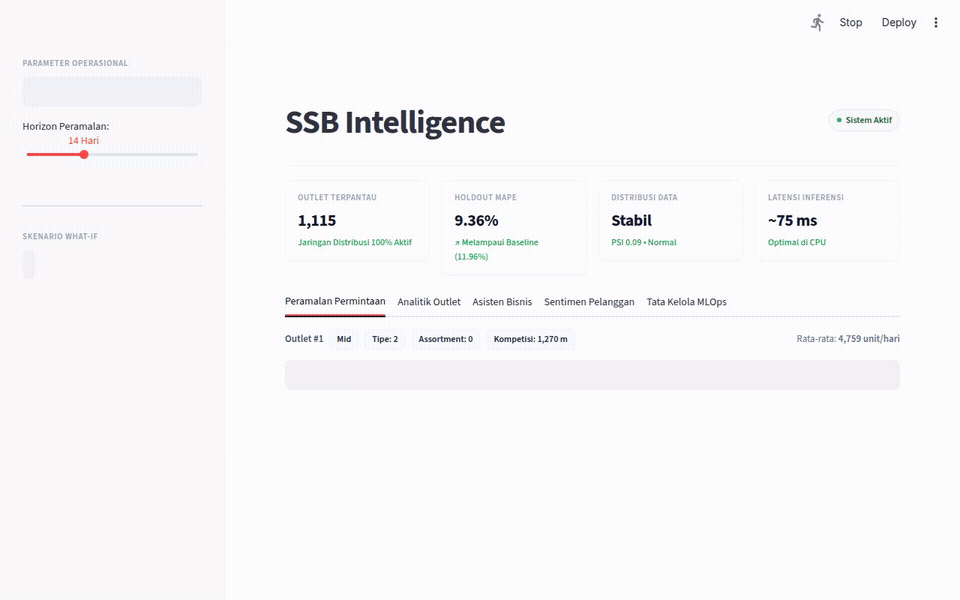
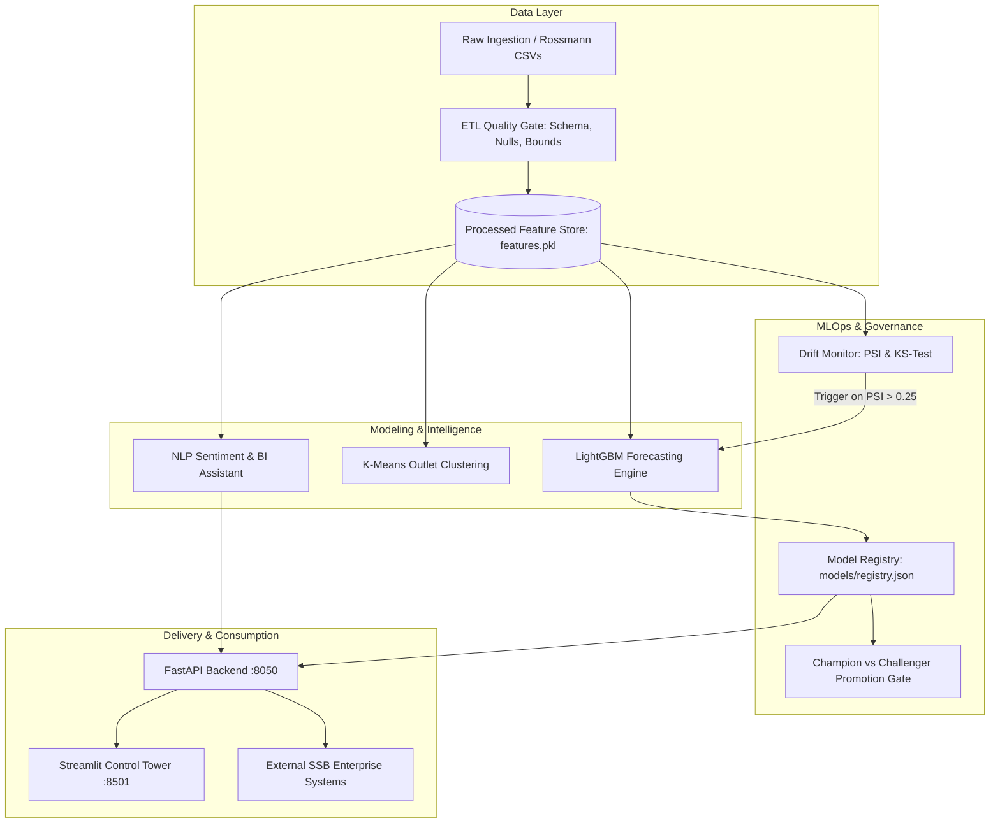

# SSB Demand & Outlet Intelligence Platform

[](https://www.python.org/)
[](#production-model-evaluation--benchmarks)
[-success.svg)](#rest-api-specification--examples)
[-emerald.svg)](#4-run-automated-tests)
[](https://fastapi.tiangolo.com)
[](https://streamlit.io)

An enterprise-grade, end-to-end Machine Learning and AI platform designed for retail and distribution networks (modeled for **SSB**). The platform integrates automated data quality ETL, 28-day store-level sales forecasting with promo simulation, unsupervised outlet clustering, Indonesian customer review sentiment analysis, natural language conversational BI, and automated MLOps drift governance.

Trained and evaluated on **1,017,209 real-world daily transaction records across 1,115 retail outlets** (Rossmann Store Sales benchmark dataset).

---

## Table of Contents
- [Live Demo & Interface](#live-demo--interface)
- [Business Problem & Solution](#business-problem--solution)
- [Mapping to AI Engineer Competencies](#mapping-to-ai-engineer-competencies)
- [System Architecture](#system-architecture)
- [Key Modules & Capabilities](#key-modules--capabilities)
- [Production Model Evaluation & Benchmarks](#production-model-evaluation--benchmarks)
- [Quickstart Guide](#quickstart-guide)
- [REST API Specification & Examples](#rest-api-specification--examples)
- [Repository Structure](#repository-structure)
- [Documentation & Model Governance](#documentation--model-governance)
- [Limitations & Scope](#limitations--scope)

---

## Live Demo & Interface



> Full high-resolution walkthrough video: **[Watch / Download Demo Video (MP4)](assets/demo.mp4)** (`1280×800`, 26s walkthrough across all 5 modules)

---

## Business Problem & Solution

In large-scale retail and distribution networks, supply chain misalignments create costly operational bottlenecks:
- **Understocking:** Leads to lost sales, stockouts, and diminished customer trust.
- **Overstocking:** Ties up working capital in perishable or depreciating inventory.
- **Data Fragmentation:** Outlets vary widely in traffic, promo sensitivity, and regional demand patterns.

### The Solution:
**SSB Demand & Outlet Intelligence** provides an automated decision-support pipeline:
1. **Accurate Forecasting:** Generates 28-day ahead daily sales forecasts per store with **9.36% MAPE**, outperforming the seasonal-naive benchmark (11.96%).
2. **What-If Promo Planner:** Simulates the volume lift of promotional events to optimize ordering.
3. **Safety Stock Recommendation:** Dynamically calculates safety buffer stock at 95% service level.
4. **Outlet Strategic Matrix:** Clusters 1,115 stores into 5 distinct operational tiers using K-Means.
5. **Conversational BI & NLP:** Allows planners to query sales data in conversational Indonesian and analyzes customer feedback sentiment.
6. **MLOps Reliability:** Proactively detects data drift via Population Stability Index (PSI) and triggers automated retraining.

---

## Mapping to AI Engineer Competencies

| Job Requirement (SSB Scope) | Implemented Module | Tech Stack | Production Deliverable |
|---|---|---|---|
| **ETL & Data Pipeline** | `ssb/etl.py` & `ssb/data.py` | Pandas, NumPy | Automated schema & range validation, leak-free feature engineering |
| **Sales Demand Forecasting** | `ssb/forecast.py` | LightGBM, Scikit-Learn | Global time-series model (400 trees), rolling CV, 28-day holdout |
| **Outlet Analytics & Segmentation** | `ssb/outlet.py` | Scikit-Learn (K-Means) | 5-tier clustering across 1,115 outlets evaluated by silhouette score |
| **NLP Sentiment Analysis** | `ssb/nlp.py` | TF-IDF, Logistic Regression | Indonesian review sentiment classifier (Macro-F1: 0.92) |
| **Conversational BI Assistant** | `ssb/nlp.py` | Rule-based Intent Engine | Natural language query engine over store sales data |
| **Software Integration (REST API)** | `ssb/api.py` | FastAPI, Pydantic, Uvicorn | Production REST API with auth (`POST /forecast`), validation, and p95 latency 111.8 ms |
| **Model Evaluation & MLOps** | `ssb/monitor.py` | SciPy (KS-Test), Custom PSI | Drift detection (PSI > 0.25), 5-scenario stress tests, model promotion gate |
| **Interactive Executive UI** | `ssb/dashboard.py` | Streamlit, Plotly Express | Minimalist enterprise control tower with what-if scenario simulator |
| **Technical Documentation** | `docs/` | Markdown, Mermaid | Comprehensive Model Card, Pipeline documentation, and User Guide |

---

## System Architecture



---

## Key Modules & Capabilities

### 1. Demand Forecasting Engine (`ssb/forecast.py`)
- **Leakage Prevention:** All lag features (`lag_28`, `lag_35`, `lag_56`) and rolling means (`roll_mean_7`, `roll_mean_28`) are shifted by $\ge 28$ days, allowing direct recursive-free multi-step ahead prediction.
- **Calendar & Store Signals:** Incorporates day-of-week, day-of-month, ISO week, month, StoreType, Assortment, and CompetitionDistance.
- **Store Closure Mask:** Automatically identifies stores that close on Sundays and suppresses predictions accordingly.
- **Safety Stock Calculator:** Computes buffer stock based on model RMSE standard error:
  $$\text{Safety Stock} = Z \times \sigma_{\text{forecast}} \times \sqrt{L}$$
  where $Z = 1.65$ (95% service level) and $L = 3$ days distribution lead time.

### 2. Outlet Segmentation Matrix (`ssb/outlet.py`)
Unsupervised K-Means clustering categorizes 1,115 stores into 5 actionable tiers based on daily sales volume, coefficient of variation, promo share, and 90-day growth:
- **Top Performer (225 outlets):** High-volume core profit drivers.
- **Strong (22 outlets):** Fast-growing outlets with high promo responsiveness.
- **Mid (602 outlets):** Stable core retail network.
- **Low (255 outlets):** Lower-density locations requiring inventory rationalization.
- **Developing (11 outlets):** New or emerging outlets exhibiting rapid sales ramps.

### 3. Natural Language Processing & BI (`ssb/nlp.py`)
- **Indonesian Review Sentiment:** Evaluates customer feedback into Positive/Negative polarity with confidence scores (< 5 ms inference).
- **Conversational BI Assistant:** Parses natural language operational questions (e.g., *"toko tertinggi 30 hari"*, *"pengaruh promo toko 2"*, *"total penjualan toko 1 30 hari"*) into executed DataFrame aggregations with execution logic transparency.

### 4. MLOps Drift Governance (`ssb/monitor.py`)
- Computes **Population Stability Index (PSI)** and **Kolmogorov-Smirnov two-sample tests** comparing current 60-day operational windows against year-ago baseline distributions.
- **Retraining Policy:** PSI > 0.25 triggers automatic model retraining; champion-challenger promotion only updates the active model version if holdout MAPE improves.
- Tested against **5 synthetic drift stress scenarios** (demand drop 40%, spike 60%, crash 55%, etc.) with 100% detection rate and 0 false alarms.

---

## Production Model Evaluation & Benchmarks

Evaluated across **3-fold rolling-origin cross-validation** (MAPE: `11.26%`, `11.63%`, `10.23%`; mean **11.04%**) and an **out-of-time future holdout of 28 calendar days** (July 2015, unseen during training):

| Metric | LightGBM Production | Seasonal-Naive Baseline | Target KPI | Result |
|---|---|---|---|---|
| **Holdout MAPE** | **9.36%** | 11.96% | $\le 20.0\%$ | **Passed** |
| **Holdout WAPE** | **8.94%** | 11.86% | - | **Passed** |
| **Holdout RMSE** | **859.51** | 1,218.02 | - | **Passed** |
| **3-Fold Rolling CV MAPE** | **11.04%** *(avg)* | - | $\le 20.0\%$ | **Passed** |
| **Outlet Clustering Silhouette** | **0.27** *(k=5, 1,115 stores)* | - | - | **Evaluated** |
| **Inference Latency (`POST /forecast`)** | **111.8 ms p95** *(53.0 ms p50)* | - | $< 300\text{ ms}$ | **Passed (CPU)** |
| **Sentiment Macro F1** | **0.92** | - | $\ge 0.75$ | **Passed** |
| **Drift Scenarios Detected** | **5 / 5 (100%)** | 0 False Alarms | 5 / 5 | **Passed** |

---

## Quickstart Guide

### Prerequisites
- Python 3.10, 3.11, or 3.12
- Linux / macOS / Windows WSL

### 1. Clone & Setup Environment
```bash
git clone https://github.com/azharzuhro12/SSB-Intelligence.git
cd SSB-Intelligence

# Create & activate virtual environment
python3 -m venv venv
source venv/bin/activate

# Install dependencies
pip install -r requirements.txt
```

### 2. Dataset Setup (Fresh Clones)
Raw datasets (`data/`) and serialized model binaries (`models/*.joblib`) are excluded from version control via `.gitignore`. You have two options:
- **Zero-config Synthetic Mode:** Run `python main.py` directly — if `data/raw/` is empty, `ssb/data.py` automatically generates a Rossmann-schema synthetic dataset (40 stores, 730 days) and trains all models cleanly.
- **Full Rossmann Benchmark (1,017,209 rows, 1,115 stores):** Place `train.csv` and `store.csv` inside `data/raw/` before running `python main.py`:
  ```bash
  mkdir -p data/raw
  curl -L http://files.fast.ai/part2/lesson14/rossmann.tgz | tar -xz -C data/raw
  ```

### 3. Multi-Mode CLI Commands (`main.py`)
The project provides a unified, production-standard entrypoint:

```bash
# A. Run full end-to-end ML pipeline (ETL -> Train -> Segment -> NLP -> Drift)
python main.py

# B. Launch Interactive Streamlit Control Tower (Port 8501)
python main.py --dashboard

# C. Launch REST API Server (Port 8050)
python main.py --api
```

### 4. Run Automated Tests
```bash
pytest -v tests
```

### 5. Run with Docker
Container exposes port `8000` internally (mapped to host port `8050` below):
```bash
docker build -t ssb-intelligence .
docker run -p 8050:8000 ssb-intelligence
```

---

## REST API Specification & Examples

Interactive Swagger documentation is available at `http://localhost:8050/docs`.  
`POST /forecast` requires the header `x-api-key: demo-key` (configurable via `SSB_API_KEY`).

### 0. Health Check (`GET /health`)
```bash
curl http://localhost:8050/health
```
**Response:** `{"status": "ok"}`

### 1. Forecast Demand (`POST /forecast`)
```bash
curl -X POST http://localhost:8050/forecast \
  -H 'x-api-key: demo-key' \
  -H 'Content-Type: application/json' \
  -d '{"store": 1, "horizon": 7}'
```
**Response:**
```json
{
  "store": 1,
  "forecast": [
    {"date": "2015-08-01", "forecast": 4984.3},
    {"date": "2015-08-02", "forecast": 0.0},
    {"date": "2015-08-03", "forecast": 4375.8},
    {"date": "2015-08-04", "forecast": 4049.8},
    {"date": "2015-08-05", "forecast": 3797.2},
    {"date": "2015-08-06", "forecast": 3763.8},
    {"date": "2015-08-07", "forecast": 4057.3}
  ]
}
```
*(Note: Sunday 2015-08-02 is automatically zeroed because Outlet #1 is closed on Sundays).*

### 2. Sentiment Analysis (`POST /sentiment`)
```bash
curl -X POST http://localhost:8050/sentiment \
  -H 'x-api-key: demo-key' \
  -H 'Content-Type: application/json' \
  -d '{"text": "pelayanan kasir sangat ramah, produk lengkap dan toko bersih"}'
```
**Response:**
```json
{
  "label": "positive",
  "score": 0.812
}
```

### 3. Natural Language BI Query (`POST /ask`)
```bash
curl -X POST http://localhost:8050/ask \
  -H 'x-api-key: demo-key' \
  -H 'Content-Type: application/json' \
  -d '{"question": "toko tertinggi 30 hari"}'
```
**Response:**
```json
{
  "answer": "Toko 262 tertinggi: 652,215 (30 hari terakhir)",
  "op": "groupby Store sum -> max"
}
```

---

## Repository Structure

```
SSB-Intelligence/
├── assets/
│   ├── demo.gif             # Inline README walkthrough animation (960x600)
│   └── demo.mp4             # Full-resolution demo video (1280x800, H.264)
├── ssb/
│   ├── __init__.py          # Module initialization
│   ├── config.py            # Project paths, horizons, and storage configurations
│   ├── data.py              # Multi-source dataset loader & fallback generator
│   ├── etl.py               # Validation gates & leak-free feature engineering
│   ├── forecast.py          # LightGBM regressor & rolling cross-validation
│   ├── outlet.py            # K-Means clustering & outlet performance profiling
│   ├── nlp.py               # TF-IDF sentiment classifier & BI intent parser
│   ├── monitor.py           # PSI / KS-test drift monitor & stress test suite
│   ├── api.py               # FastAPI application & authentication middleware
│   └── dashboard.py         # Minimalist enterprise Streamlit control tower
├── docs/
│   ├── MODEL_CARD.md        # Governance, model specs, data provenance, limitations
│   ├── PIPELINE.md          # ETL architecture, idempotency, and data quality gates
│   └── USER_GUIDE.md        # Operational guide for planners, engineers, and reviewers
├── models/
│   └── registry.json        # Champion model metadata (joblib binaries gitignored)
├── reports/                 # Stored model evaluation JSONs, segments, and drift logs
├── tests/
│   └── test_all.py          # Validation, API contract, latency, and NLP test suite
├── Dockerfile               # Production container image (exposes port 8000)
├── pytest.ini               # Pytest root pythonpath configuration
├── requirements.txt         # Pinned production dependencies
├── main.py                  # Multi-mode CLI entrypoint
└── README.md                # Project documentation
```
*(Note: `data/` and `models/*.joblib` are excluded via `.gitignore` and generated locally when running `python main.py`.)*

---

## Documentation & Model Governance

For technical and governance deep-dives, consult the following documentation:
- **[Model Card (docs/MODEL_CARD.md)](docs/MODEL_CARD.md):** Complete architectural parameters, intended use, ethical considerations, and known limitations.
- **[Pipeline Architecture (docs/PIPELINE.md)](docs/PIPELINE.md):** ETL validation rules, data contracts, and scheduling workflows.
- **[User Guide (docs/USER_GUIDE.md)](docs/USER_GUIDE.md):** End-to-end user manual for supply chain planners and software integration teams.

---

## Limitations & Scope
- **Sentiment Corpus:** The Indonesian customer review classifier (`ssb/nlp.py`) is trained on a curated synthetic Indonesian corpus for portfolio demonstration and should be retrained on real production reviews prior to live deployment.
- **BI Assistant Engine:** The Q&A assistant executes deterministic rule-based intent parsing over local DataFrames (no external LLM calls required, guaranteeing zero API cost and full data privacy).
- **Computer Vision / CCTV Module:** Planned for v2.0 outside the current v1.0 tabular/NLP release scope.
