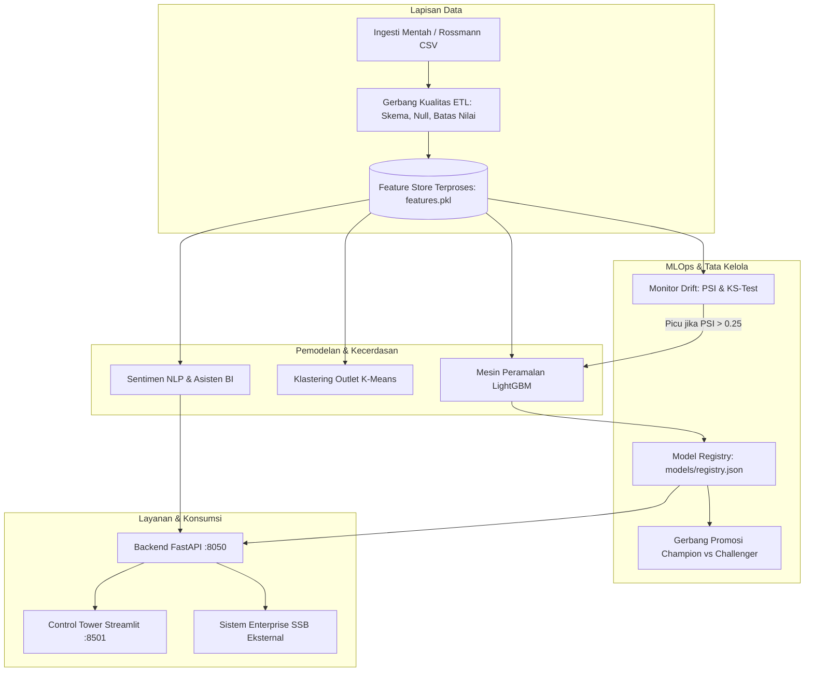

# SSB Demand & Outlet Intelligence Platform

[](https://www.python.org/)
[](#evaluasi-model--benchmark-produksi)
[-success.svg)](#spesifikasi--contoh-rest-api)
[-emerald.svg)](#4-jalankan-pengujian-otomatis)
[](https://fastapi.tiangolo.com)
[](https://streamlit.io)

Platform Machine Learning dan AI *end-to-end* berstandar produksi yang dirancang untuk jaringan ritel dan distribusi (dimodelkan untuk **SSB**). Platform ini mengintegrasikan ETL penjaminan kualitas data otomatis, peramalan penjualan harian 28 hari per outlet beserta simulasi promo, klastering outlet tanpa supervisi, analisis sentimen ulasan pelanggan berbahasa Indonesia, asisten BI berbasis bahasa natural, serta tata kelola pemantauan drift MLOps otomatis.

Dilatih dan dievaluasi pada **1.017.209 catatan transaksi harian nyata di 1.115 outlet ritel** (dataset benchmark Rossmann Store Sales).

---

## Daftar Isi
- [Demo Video & Tampilan](#demo-video--tampilan)
- [Permasalahan Bisnis & Solusi](#permasalahan-bisnis--solusi)
- [Pemetaan Kompetensi AI Engineer](#pemetaan-kompetensi-ai-engineer)
- [Arsitektur Sistem](#arsitektur-sistem)
- [Modul Utama & Kapabilitas](#modul-utama--kapabilitas)
- [Evaluasi Model & Benchmark Produksi](#evaluasi-model--benchmark-produksi)
- [Panduan Memulai (Quickstart)](#panduan-memulai-quickstart)
- [Spesifikasi & Contoh REST API](#spesifikasi--contoh-rest-api)
- [Struktur Repositori](#struktur-repositori)
- [Dokumentasi & Tata Kelola Model](#dokumentasi--tata-kelola-model)
- [Batasan & Ruang Lingkup](#batasan--ruang-lingkup)

---

## Demo Video & Tampilan


> Video demo resolusi penuh: **[Tonton / Unduh Video Demo (MP4)](assets/demo.mp4)** (`1280×800`, walkthrough 26 detik melintasi seluruh 5 modul)

---

## Permasalahan Bisnis & Solusi

Pada jaringan ritel dan distribusi berskala besar, ketidakselarasan rantai pasok sering menimbulkan hambatan operasional yang mahal:
- **Kekurangan Stok (Understocking):** Menyebabkan kehilangan penjualan, kekosongan barang (*stockout*), dan menurunnya kepercayaan pelanggan.
- **Kelebihan Stok (Overstocking):** Mengikat modal kerja pada persediaan yang berisiko kedaluwarsa atau menyusut nilainya.
- **Fragmentasi Data:** Setiap outlet memiliki karakteristik trafik, sensitivitas promo, dan pola permintaan wilayah yang sangat berbeda.

### Solusi yang Dibangun:
**SSB Demand & Outlet Intelligence** menyediakan pipeline pendukung keputusan (*decision-support*) otomatis:
1. **Peramalan Akurat:** Menghasilkan prediksi penjualan harian 28 hari ke depan per toko dengan **MAPE 9,36%**, mengungguli baseline seasonal-naive (11,96%).
2. **Perencana Promo What-If:** Mensimulasikan lonjakan volume akibat kampanye promosi untuk mengoptimalkan pemesanan stok.
3. **Rekomendasi Safety Stock:** Menghitung stok pengaman secara dinamis pada tingkat layanan (*service level*) 95%.
4. **Matriks Strategis Outlet:** Mengelompokkan 1.115 toko ke dalam 5 tingkatan operasional menggunakan K-Means.
5. **BI Percakapan & NLP:** Memungkinkan perencana menanyakan data penjualan dalam Bahasa Indonesia alami sekaligus menganalisis sentimen ulasan pelanggan.
6. **Keandalan MLOps:** Mendeteksi pergeseran data (*data drift*) secara proaktif menggunakan Population Stability Index (PSI) dan memicu pelatihan ulang otomatis.

---

## Pemetaan Kompetensi AI Engineer

| Kebutuhan Peran (Lingkup SSB) | Modul Terimplementasi | Tech Stack | Hasil Produksi |
|---|---|---|---|
| **ETL & Pipeline Data** | `ssb/etl.py` & `ssb/data.py` | Pandas, NumPy | Validasi skema & rentang otomatis, rekayasa fitur bebas kebocoran (*leak-free*) |
| **Peramalan Permintaan Penjualan** | `ssb/forecast.py` | LightGBM, Scikit-Learn | Model time-series global (400 tree), rolling CV, holdout 28 hari |
| **Analitik & Segmentasi Outlet** | `ssb/outlet.py` | Scikit-Learn (K-Means) | Klastering 5 tingkat di 1.115 outlet yang dievaluasi dengan silhouette score |
| **Analisis Sentimen NLP** | `ssb/nlp.py` | TF-IDF, Logistic Regression | Pengklasifikasi sentimen ulasan Bahasa Indonesia (Macro-F1: 0,92) |
| **Asisten BI Percakapan** | `ssb/nlp.py` | Rule-based Intent Engine | Mesin kueri bahasa natural di atas data penjualan toko |
| **Integrasi Perangkat Lunak (REST API)** | `ssb/api.py` | FastAPI, Pydantic, Uvicorn | REST API produksi dengan autentikasi (`x-api-key`), validasi, dan latensi p95 111,8 ms |
| **Evaluasi Model & MLOps** | `ssb/monitor.py` | SciPy (KS-Test), Custom PSI | Deteksi drift (`PSI > 0,25`), 5 skenario uji stres, gerbang promosi model |
| **UI Eksekutif Interaktif** | `ssb/dashboard.py` | Streamlit, Plotly Express | Control tower perusahaan minimalis dengan simulator skenario what-if |
| **Dokumentasi Teknis** | `docs/` | Markdown, Mermaid | Model Card, dokumentasi Pipeline, dan Panduan Pengguna lengkap |

---

## Arsitektur Sistem



---

## Modul Utama & Kapabilitas

### 1. Mesin Peramalan Permintaan (`ssb/forecast.py`)
- **Pencegahan Kebocoran Data:** Seluruh fitur lag (`lag_28`, `lag_35`, `lag_56`) dan rata-rata bergulir (`roll_mean_7`, `roll_mean_28`) digeser $\ge 28$ hari sehingga mendukung prediksi multi-hari langsung tanpa rekursi.
- **Sinyal Kalender & Toko:** Memanfaatkan hari dalam minggu, tanggal, minggu ISO, bulan, `StoreType`, `Assortment`, dan `CompetitionDistance`.
- **Masker Toko Tutup:** Mendeteksi toko yang tutup pada hari Minggu secara otomatis dan mengenolkan prediksi pada hari tersebut.
- **Kalkulator Safety Stock:** Menghitung stok penyangga (*buffer stock*) berdasarkan galat standar RMSE model:
  $$\text{Safety Stock} = Z \times \sigma_{\text{forecast}} \times \sqrt{L}$$
  dengan $Z = 1{,}65$ (tingkat layanan 95%) dan $L = 3$ hari waktu tunggu distribusi (*lead time*).

### 2. Matriks Segmentasi Outlet (`ssb/outlet.py`)
Klastering K-Means tanpa supervisi mengelompokkan 1.115 toko ke dalam 5 segmen operasional berdasarkan volume penjualan harian, koefisien variasi, rasio promo, dan pertumbuhan 90 hari:
- **Top Performer (225 outlet):** Penggerak laba utama bervolume tinggi.
- **Strong (22 outlet):** Outlet bertumbuh cepat dengan respons tinggi terhadap promo.
- **Mid (602 outlet):** Jaringan ritel inti yang stabil.
- **Low (255 outlet):** Lokasi berdensitas lebih rendah yang memerlukan rasionalisasi stok.
- **Developing (11 outlet):** Outlet baru atau berkembang yang menunjukkan kenaikan penjualan pesat.

### 3. Pemrosesan Bahasa Natural & BI (`ssb/nlp.py`)
- **Sentimen Ulasan Bahasa Indonesia:** Mengklasifikasikan masukan pelanggan menjadi polaritas Positif/Negatif beserta skor keyakinan (inferensi `< 5 ms`).
- **Asisten BI Percakapan:** Mengurai pertanyaan operasional dalam bahasa alami (misalnya *"toko tertinggi 30 hari"*, *"pengaruh promo toko 2"*, *"total penjualan toko 1 30 hari"*) menjadi agregasi DataFrame lengkap beserta transparansi logika eksekusinya.

### 4. Tata Kelola Drift MLOps (`ssb/monitor.py`)
- Menghitung **Population Stability Index (PSI)** dan **uji dua sampel Kolmogorov-Smirnov** dengan membandingkan jendela operasional 60 hari terkini terhadap distribusi baseline setahun sebelumnya.
- **Kebijakan Pelatihan Ulang:** Nilai `PSI > 0,25` memicu retraining model otomatis; gerbang promosi champion-challenger hanya memperbarui versi model aktif apabila holdout MAPE membaik.
- Diuji terhadap **5 skenario uji stres drift sintetis** (penurunan permintaan 40%, lonjakan 60%, anjlok 55%, dll.) dengan tingkat deteksi 100% dan 0 alarm palsu.

---

## Evaluasi Model & Benchmark Produksi

Dievaluasi menggunakan **3-fold rolling-origin cross-validation** (MAPE per fold: `11,26%`, `11,63%`, `10,23%`; rata-rata **11,04%**) serta **holdout masa depan di luar sampel selama 28 hari kalender** (Juli 2015, tidak terlihat saat pelatihan):

| Metrik | LightGBM Produksi | Baseline Seasonal-Naive | Target KPI | Hasil |
|---|---|---|---|---|
| **Holdout MAPE** | **9,36%** | 11,96% | $\le 20{,}0\%$ | **Lulus** |
| **Holdout WAPE** | **8,94%** | 11,86% | - | **Lulus** |
| **Holdout RMSE** | **859,51** | 1.218,02 | - | **Lulus** |
| **3-Fold Rolling CV MAPE** | **11,04%** *(rata-rata)* | - | $\le 20{,}0\%$ | **Lulus** |
| **Silhouette Klastering Outlet** | **0,27** *(k=5, 1.115 toko)* | - | - | **Terevaluasi** |
| **Latensi Inferensi (`POST /forecast`)** | **111,8 ms p95** *(53,0 ms p50)* | - | $< 300\text{ ms}$ | **Lulus (CPU)** |
| **Sentiment Macro F1** | **0,92** | - | $\ge 0{,}75$ | **Lulus** |
| **Skenario Drift Terdeteksi** | **5 / 5 (100%)** | 0 Alarm Palsu | 5 / 5 | **Lulus** |

---

## Panduan Memulai (Quickstart)

### Prasyarat
- Python 3.10, 3.11, atau 3.12
- Linux / macOS / Windows WSL

### 1. Clone & Siapkan Environment
```bash
git clone https://github.com/azharzuhro12/SSB-Intelligence.git
cd SSB-Intelligence

# Buat & aktifkan virtual environment
python3 -m venv venv
source venv/bin/activate

# Pasang seluruh dependensi
pip install -r requirements.txt
```

### 2. Pengaturan Dataset (Fresh Clone)
Dataset mentah (`data/`) dan biner model terlatih (`models/*.joblib`) dikecualikan dari repositori melalui `.gitignore`. Anda dapat memilih salah satu dari dua opsi berikut:
- **Mode Sintetis Otomatis (Tanpa Konfigurasi):** Jalankan `python main.py` secara langsung — jika `data/raw/` kosong, `ssb/data.py` otomatis membuat dataset sintetis berstruktur Rossmann (40 toko, 730 hari) dan melatih seluruh model dengan lancar.
- **Benchmark Penuh Rossmann (1.017.209 baris, 1.115 toko):** Letakkan `train.csv` dan `store.csv` ke dalam folder `data/raw/` sebelum menjalankan `python main.py`:
  ```bash
  mkdir -p data/raw
  curl -L http://files.fast.ai/part2/lesson14/rossmann.tgz | tar -xz -C data/raw
  ```

### 3. Perintah CLI Multi-Mode (`main.py`)
Proyek ini menyediakan satu *entrypoint* terpadu standar produksi:

```bash
# A. Jalankan pipeline ML end-to-end lengkap (ETL -> Train -> Segment -> NLP -> Drift)
python main.py

# B. Jalankan Control Tower Streamlit Interaktif (Port 8501)
python main.py --dashboard

# C. Jalankan Server REST API (Port 8050)
python main.py --api
```

### 4. Jalankan Pengujian Otomatis
```bash
pytest -v tests
```

### 5. Jalankan dengan Docker
Container mengekspos port `8000` di dalam kontainer (dipetakan ke port host `8050` pada contoh di bawah):
```bash
docker build -t ssb-intelligence .
docker run -p 8050:8000 ssb-intelligence
```

---

## Spesifikasi & Contoh REST API

Dokumentasi interaktif Swagger tersedia di `http://localhost:8050/docs`.  
Seluruh endpoint `POST` membutuhkan header `x-api-key: demo-key` (dapat dikonfigurasi melalui variabel lingkungan `SSB_API_KEY`).

### 0. Cek Kesehatan Layanan (`GET /health`)
```bash
curl http://localhost:8050/health
```
**Respons:** `{"status": "ok"}`

### 1. Peramalan Permintaan (`POST /forecast`)
```bash
curl -X POST http://localhost:8050/forecast \
  -H 'x-api-key: demo-key' \
  -H 'Content-Type: application/json' \
  -d '{"store": 1, "horizon": 7}'
```
**Respons:**
```json
{
  "store": 1,
  "forecast": [
    {"date": "2015-08-01", "forecast": 4984.3},
    {"date": "2015-08-02", "forecast": 0.0},
    {"date": "2015-08-03", "forecast": 4375.8},
    {"date": "2015-08-04", "forecast": 4049.8},
    {"date": "2015-08-05", "forecast": 3797.2},
    {"date": "2015-08-06", "forecast": 3763.8},
    {"date": "2015-08-07", "forecast": 4057.3}
  ]
}
```
*(Catatan: Tanggal Minggu 2015-08-02 otomatis bernilai 0 karena Outlet #1 tutup pada hari Minggu).*

### 2. Analisis Sentimen (`POST /sentiment`)
```bash
curl -X POST http://localhost:8050/sentiment \
  -H 'x-api-key: demo-key' \
  -H 'Content-Type: application/json' \
  -d '{"text": "pelayanan kasir sangat ramah, produk lengkap dan toko bersih"}'
```
**Respons:**
```json
{
  "label": "positive",
  "score": 0.812
}
```

### 3. Kueri BI Bahasa Natural (`POST /ask`)
```bash
curl -X POST http://localhost:8050/ask \
  -H 'x-api-key: demo-key' \
  -H 'Content-Type: application/json' \
  -d '{"question": "toko tertinggi 30 hari"}'
```
**Respons:**
```json
{
  "answer": "Toko 262 tertinggi: 652,215 (30 hari terakhir)",
  "op": "groupby Store sum -> max"
}
```

---

## Struktur Repositori

```
SSB-Intelligence/
├── assets/
│   ├── demo.gif             # Animasi walkthrough inline untuk README (960x600)
│   └── demo.mp4             # Video demo resolusi penuh (1280x800, H.264)
├── ssb/
│   ├── __init__.py          # Inisialisasi modul
│   ├── config.py            # Konfigurasi path proyek, horizon, dan penyimpanan
│   ├── data.py              # Loader dataset multi-sumber & generator fallback sintetis
│   ├── etl.py               # Gerbang validasi & rekayasa fitur bebas kebocoran data
│   ├── forecast.py          # Regressor LightGBM & rolling cross-validation
│   ├── outlet.py            # Klastering K-Means & pemrofilan performa outlet
│   ├── nlp.py               # Pengklasifikasi sentimen TF-IDF & parser intent BI
│   ├── monitor.py           # Monitor drift PSI / KS-test & suite uji stres
│   ├── api.py               # Aplikasi FastAPI & middleware autentikasi
│   └── dashboard.py         # Control tower Streamlit minimalis berstandar enterprise
├── docs/
│   ├── MODEL_CARD.md        # Tata kelola, spesifikasi model, asal data, dan batasan
│   ├── PIPELINE.md          # Arsitektur ETL, idempotensi, dan gerbang kualitas data
│   └── USER_GUIDE.md        # Panduan operasional untuk perencana, engineer, dan reviewer
├── models/
│   └── registry.json        # Metadata model champion (file joblib di-gitignore)
├── reports/                 # Laporan JSON evaluasi model, segmen, dan log drift
├── tests/
│   └── test_all.py          # Suite pengujian validasi, kontrak API, latensi, dan NLP
├── Dockerfile               # Image kontainer produksi (mengekspos port 8000)
├── pytest.ini               # Konfigurasi root pythonpath untuk Pytest
├── requirements.txt         # Daftar dependensi produksi
├── main.py                  # Entrypoint CLI multi-mode
└── README.md                # Dokumentasi proyek
```
*(Catatan: Folder `data/` dan file `models/*.joblib` dikecualikan melalui `.gitignore` serta akan dibuat secara lokal ketika menjalankan `python main.py`.)*

---

## Dokumentasi & Tata Kelola Model

Untuk pendalaman teknis dan tata kelola model, silakan merujuk pada dokumen berikut:
- **[Model Card (docs/MODEL_CARD.md)](docs/MODEL_CARD.md):** Parameter arsitektur lengkap, tujuan penggunaan, pertimbangan etis, dan batasan yang diketahui.
- **[Arsitektur Pipeline (docs/PIPELINE.md)](docs/PIPELINE.md):** Aturan validasi ETL, kontrak data, dan alur penjadwalan.
- **[Panduan Pengguna (docs/USER_GUIDE.md)](docs/USER_GUIDE.md):** Panduan penggunaan menyeluruh bagi tim perencana rantai pasok dan integrasi perangkat lunak.

---

## Batasan & Ruang Lingkup
- **Korpus Sentimen:** Pengklasifikasi ulasan pelanggan berbahasa Indonesia (`ssb/nlp.py`) dilatih pada korpus sintetis terkurasi untuk keperluan demonstrasi portofolio dan perlu dilatih ulang menggunakan ulasan produksi nyata sebelum penerapan langsung.
- **Mesin Asisten BI:** Asisten tanya-jawab mengeksekusi penguraian intent deterministik berbasis aturan di atas DataFrame lokal (tanpa panggilan LLM eksternal sehingga bebas biaya API dan menjaga penuh privasi data).
- **Modul Computer Vision / CCTV:** Direncanakan untuk rilis v2.0 di luar cakupan tabular/NLP pada rilis v1.0 saat ini.
