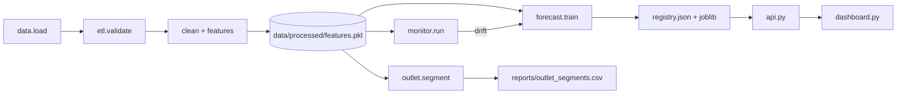

# Pipeline Documentation

- **Validation (fails run):** non-null keys, no duplicate (Store, Date), Sales ≥ 0, Promo ∈ {0,1}.
- **Idempotency:** outputs overwritten; synthetic data seeded.
- **Scheduling:** `python -c "from ssb import monitor; monitor.run()"` via cron (e.g. weekly).
- **Registry:** each training adds a version; `current` changes only if holdout MAPE does not worsen.
